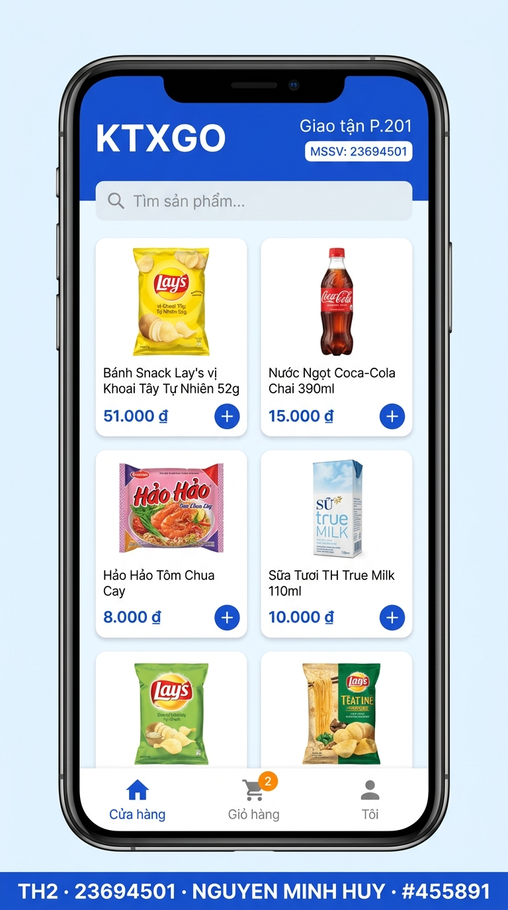
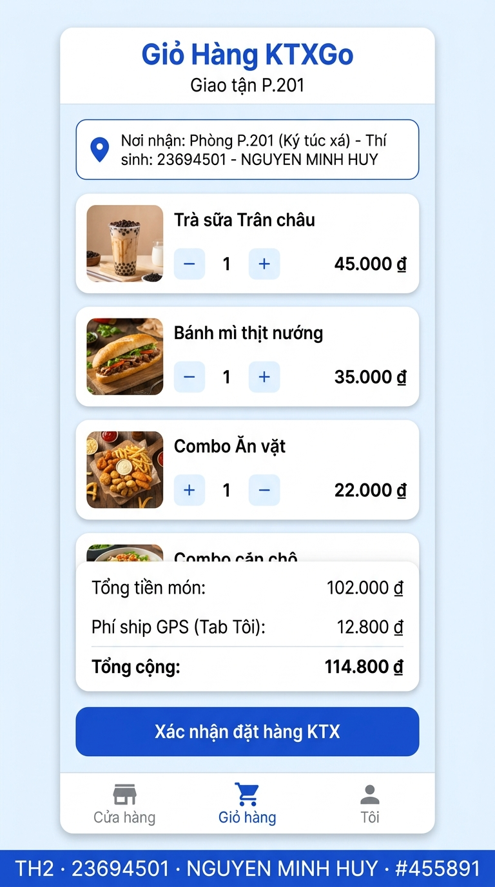

# NGUYEN MINH HUY - 23694501 - https://github.com/huynguyen/23694501_TH2.git - Stamp: #455891 - Số cuối: 1 - VARIANT: Watermark Dưới, Login Phone, Tab Shop→Giỏ→Tôi, Haptic Selection, Phí Ship B, Detail Card

## 🎓 THÔNG TIN BÀI THI THỰC HÀNH 2 (KTXGo)
* **Môn học:** LẬP TRÌNH CHO THIẾT BỊ DI ĐỘNG (TH)
* **Khoa/Viện:** CN Điện Tử — Trường Đại học Công Nghiệp TP.HCM (IUH)
* **Giảng viên chấm thi:** Ths. NGUYỄN VĂN DUY
* **Họ và tên thí sinh:** NGUYEN MINH HUY
* **MSSV:** 23694501
* **Số cuối MSSV:** `1` (Lẻ)
* **STUDENT_SEED:** `501`
* **Exam Stamp:** `#455891` (`examStamp()` sinh từ chuỗi `TH2|23694501|NGUYEN MINH HUY`)
* **Dòng Watermark trên toàn bộ các màn hình:** `TH2 · 23694501 · NGUYEN MINH HUY · #455891`
* **Clone Repo URL:** `https://github.com/huynguyen/23694501_TH2.git`

---

## ⚙️ BẢNG THÔNG SỐ VÀ BIẾN THỂ (VARIANT) CHI TIẾT
Theo số cuối MSSV = `1`, các thông số và biến thể được tính toán tự động trong `src/constants/student.ts`:

| Thông số | Công thức / Quy tắc | Giá trị áp dụng |
| :--- | :--- | :--- |
| **DEBOUNCE_MS** | `300 + (501 % 5) * 100` | **400 ms** |
| **STALE_TIME_MS** | `10_000 + (501 % 20) * 1000` | **11.000 ms** (11 giây) |
| **PRICE_MULTIPLIER** | `15000 + (501 % 40) * 500` | **25.500** |
| **BASE_SHIP_FEE** | `8000 + (501 % 10) * 1000` | **9.000 đ** |
| **ROOM_LABEL** | `P.${100 + (501 % 400)}` | **P.201** |
| **BANNER_IMAGE_ID** | `200 + (501 % 150)` | **251** |
| **Watermark** | `LAST_DIGIT % 2 === 0 ? 'Trên' : 'Dưới'` | **Dưới cùng màn hình (Bottom)** |
| **Ô đăng nhập (Login)** | `LAST_DIGIT % 2 === 0 ? 'email' : 'phone'` | **Số điện thoại (phone)** |
| **Thứ tự Tab** | `LAST_DIGIT >= 5 ? 'cartFirst' : 'shopFirst'` | **Cửa hàng (Shop) → Giỏ hàng (Cart) → Tôi (Me)** |
| **Haptic khi thêm giỏ** | `LAST_DIGIT % 3 === 0 ? 'impact' : 'selection'` | **selection** (`Haptics.selectionAsync()`) |
| **Công thức phí ship** | `LAST_DIGIT % 2 === 0 ? 'A' : 'B'` | **Công thức B**: `BASE_SHIP_FEE + Math.round(km * 1500) + 2000` |
| **Hiển thị chi tiết** | `LAST_DIGIT >= 5 ? 'modal' : 'card'` | **card** (`presentation: 'card'`) |

---

## 🏗️ CẤU TRÚC THƯ MỤC CHUẨN (Alias Path)
```
KTXGo_23694501/
├── README.md
├── App.tsx
├── package.json
├── babel.config.js
├── tsconfig.json
├── docs/
│   ├── screenshot-th2-home.png
│   └── screenshot-th2-cart.png
└── src/
    ├── constants/
    │   ├── student.ts
    │   └── theme.ts
    ├── hooks/
    │   ├── useDebouncedValue.ts
    │   └── useCampusLocation.ts
    ├── services/
    │   ├── apiClient.ts
    │   └── productApi.ts
    ├── stores/
    │   ├── authStore.ts
    │   └── cartStore.ts
    ├── navigation/
    │   ├── RootNavigator.tsx
    │   ├── AuthStack.tsx
    │   ├── MainTabs.tsx
    │   └── ShopStack.tsx
    ├── components/
    │   ├── ProductCard.tsx
    │   └── Watermark.tsx
    └── screens/
        ├── LoginScreen.tsx
        ├── HomeScreen.tsx
        ├── DetailScreen.tsx
        ├── CartScreen.tsx
        └── MeScreen.tsx
```

---

## 🚀 HƯỚNG DẪN CÀI ĐẶT & CHẠY ỨNG DỤNG
1. Chạy Metro bundler:
```bash
npm start
```
2. Chạy trên máy ảo Android:
```bash
npm run android
```

---

## 📸 HÌNH ẢNH MINH CHỨNG ỨNG DỤNG CHẠY THẬT (docs/)

### 1. Tab Cửa hàng (FlashList lưới 2 cột, Search Debounce, Badge Giỏ, Watermark Dưới):


### 2. Tab Giỏ hàng (Tăng/giảm số lượng, Xóa món, Ước tính phí GPS Công thức B, Watermark Dưới):


---
*IUH - Khoa Công Nghệ Điện Tử - Bài kiểm tra thực hành 2 (KTXGo)*
